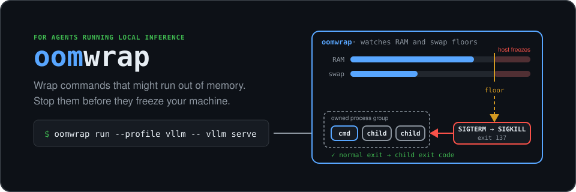

# oomwrap

<p align="center">
  
</p>

<p align="center"><strong>Wrap commands that might cause out-of-memory errors, and stop them before they freeze your machine</strong></p>

oomwrap is a memory guard for one Linux command at a time, made for agents that
launch local inference engines and other memory-heavy jobs. It runs the command
in its own cgroup scope with kernel memory limits, and it stops every process of
the job when the memory pressure that the kernel reports would freeze the
machine.

Use it when an agent starts an inference engine such as llama.cpp or vLLM, and
for large builds and data jobs. oomwrap works next to machine-wide tools such as
`earlyoom`, which stay the fallback for everything else on the machine.

## Install

Install oomwrap from crates.io:

```bash
cargo install oomwrap --locked
```

Each [release](https://github.com/osolmaz/oomwrap/releases) also has static
binaries for `x86_64` and `aarch64` Linux, with SHA-256 checksums and build
provenance attestations. To check a downloaded binary:

```bash
sha256sum --check --ignore-missing SHA256SUMS
gh attestation verify oomwrap-<version>-<arch>-linux-musl --repo osolmaz/oomwrap
```

Then check what the machine offers:

```bash
oomwrap doctor
```

`doctor` changes nothing. It reports which backend oomwrap will use and why. It
also shows the memory that the job will compete for and where each setting comes
from. When something needs repair, it prints the command that repairs it.

## Run a command

Put the command after `--`:

```bash
oomwrap run --profile generic -- ./build-large-project.sh
```

The defaults come from the machine, so most runs need no numbers. oomwrap finds
the memory that the job competes for, which is the whole machine, or the cgroup
of a container or a limited service when its limit is smaller. Every share below is
a share of that memory.

| Option | Default | Meaning |
| --- | --- | --- |
| `--memory-max` | the smallest of `85%`, the free room at launch minus `--min-mem`, and any lower limit above the job | The job's hard limit. At this limit the kernel reclaims, then kills inside the job |
| `--memory-high` | `90%` of `--memory-max` | The job's soft limit. Above it the kernel slows the job and reclaims its pages first |
| `--memory-swap-max` | not set | The job's own swap limit |
| `--min-mem` | `15%`, at least `256M`, at most `16G` | The free room that must stay for the rest of the machine |
| `--job-pressure`, `--job-pressure-for` | `60%`, `30s` | How long the job may stall on memory |
| `--domain-pressure`, `--domain-pressure-for` | `10%`, `10s` | How long the machine may stall on memory while it is short of memory |

A size is a binary unit (`512M`, `24G`), a share (`85%`) or `infinity`. A
pressure is the kernel's `full avg10` figure, the share of the last 10 seconds
in which every running task waited for memory.

oomwrap stops the job when its scope hits `--memory-max`, when the job's own
pressure lasts, when the free room falls below `--min-mem`, or when the machine
is short of memory and its pressure lasts. A stop sends `SIGTERM` to every
process of the job. After `--term-grace` (default `10s`) it kills the whole
scope, also processes that left the process group with `setsid()`. When
the command ends on its own, oomwrap ends the processes that it left behind.
Before the launch, oomwrap refuses to start a job when there is no room for it.

## Backends

oomwrap has two ways to guard a job. `--backend auto`, the default, takes
`cgroup` when the machine supports it and `poll` otherwise. The event log says
which one it took and why.

The `cgroup` backend runs the job in a transient scope of the systemd user
manager, with the kernel limits above. It needs cgroup v2, Linux 5.14 or later,
and a user manager that outlives your login (`loginctl enable-linger`, which
`doctor` names when it is off). A job that runs as root uses the system manager.

The `poll` backend watches the job's process group once per `--poll` (default
`1s`) without kernel limits. oomwrap uses it where the `cgroup` backend cannot run
or could let the job escape a limit, for example in a container or a CI job. It does
not catch a child that left the process group.

A job limit that you give with a flag or in the policy file needs the `cgroup`
backend. When the machine cannot give it, oomwrap exits with 3 and runs
nothing, so a job never runs without the limit that it asked for.

## Policy file

oomwrap reads `/etc/oomwrap.toml` and then
`${XDG_CONFIG_HOME:-~/.config}/oomwrap/config.toml`. The keys are the flag
names, and a section can set values for one profile:

```toml
min-mem = "2G"
machine-guards = ["my-guard"]

[profile.vllm]
memory-max = "80%"
require-machine-guard = false
```

A flag wins over the user file, and the user file wins over the system file.
Inside a file, the profile section wins over the top. A key or value that
oomwrap does not know stops the launch with exit 2, and the message names the
place in the file.
`oomwrap doctor --profile <name>` shows each value with its source.

## Use with earlyoom

[`earlyoom`](https://github.com/rfjakob/earlyoom) is a Linux daemon that acts
before the kernel's out-of-memory killer. When available memory and free swap
both fall below its thresholds, it sends `SIGTERM` to the process with the
highest `oom_score`. At a lower emergency threshold it sends `SIGKILL`. It protects
the whole machine, so it can stop a process outside the current job.

oomwrap guards only the job that it starts and stops the whole job when a limit
holds. It also sets the job's `oom_score_adj` to `1000`, so that a machine-wide
killer picks the job before anything else. Use both on a workstation, so that
oomwrap acts on the job first and `earlyoom` stays the fallback for the rest.

The inference profiles require a machine-wide guard by default. A running
`earlyoom` counts as one. So does `systemd-oomd` when it watches the job's
cgroup, and the policy file can name another guard in `machine-guards`. Without one, an
inference profile exits with 3. Use `--allow-no-machine-guard` only for tests or
on a machine with another safety net.

```bash
systemctl is-active earlyoom
sudo journalctl -u earlyoom | grep sending
```

## Run inference engines

oomwrap detects known inference engines from the command:

```bash
oomwrap run -- llama-server --model model.gguf
```

The profiles are `auto`, `vllm`, `llama-cpp`, `sglang`, `trtllm`, `tgi` and
`generic`. Give a profile with `--profile` when a script or wrapper hides the
engine command, and use `generic` for other commands.

## Event logs

oomwrap writes one JSON line for each launch, refusal, stop and exit to
`${XDG_STATE_HOME:-~/.local/state}/oomwrap/`, one file per day, kept for 14
days. A stop event names the reason and holds the readings that decided it.

```bash
oomwrap run --event-log ./job.events.jsonl -- ./memory-heavy-command
```

`--event-log none` turns the log off. Events hold the program name only,
because arguments can hold tokens; `--log-command` adds the full command line.

## Shims and wrappers

PATH shims let existing commands run through oomwrap without a change to each
script:

```bash
oomwrap install-shims
oomwrap uninstall-shims
```

This writes shims for common inference tools into `~/.local/bin`. Put that
folder before the real tools in `PATH`.

`wrap` guards a program at a fixed path. It moves the program to
`<path>.real` and writes a wrapper in its place, and `unwrap` puts it back:

```bash
oomwrap wrap /opt/llama.cpp/bin/llama-server
oomwrap unwrap /opt/llama.cpp/bin/llama-server
```

Shims and wrappers hold no policy. They call `oomwrap run --shim <tool>`, and
the policy file and the defaults decide the limits.

## Exit codes

| Code | Meaning |
| --- | --- |
| the command's code | The command ended on its own |
| 2 | Invalid arguments or policy file, or oomwrap lost its readings after the launch and ended the job |
| 3 | oomwrap cannot guard the job as asked, for example because a required machine-wide guard is not running |
| 4 | There is no room for the job now, so oomwrap did not start it |
| 126, 127 | The command could not be run, or was not found |
| 128 + n | oomwrap received signal n and ended the job |
| 137 | oomwrap stopped the job, and the event log names the reason |

A job killed with `SIGKILL` by another tool also ends with 137, so the event
log is the record of why a job ended.

## Limits

oomwrap runs only on Linux. The pressure stops need the kernel's pressure
figures (PSI, Linux 4.20 or later); without them only the floor and the kernel
limits stop a job, and `doctor` says so.

On a machine where the GPU shares the system memory, the job's cgroup does not
count the GPU's allocations. In one measured model load, the GPU held 1.6 GiB
while the job's cgroup counted 0.6 GiB, so `--memory-max` does not bound that
memory. The free room and the machine's pressure still include it, and
`--min-mem` and `--domain-pressure` still stop the job.

Each job's default `--memory-max` uses the free room at its own launch. Jobs
that start at the same time can each count on the same room, and then only the
floor and the machine's pressure guard their sum.

## Upgrade from 0.1.0

0.2.0 removes `--min-swap`, `--require-earlyoom` and `--allow-no-earlyoom`, and
an unknown flag before the command is now an error. Shims and wrappers of 0.1.0
pass old flags and fail until you write them again. The
[changelog](CHANGELOG.md) lists the steps, and `oomwrap doctor` names each
outdated shim or wrapper with the command that rewrites it.

## Agent skill

The `memory-safe-launch` skill in
[`.agents/skills/memory-safe-launch`](.agents/skills/memory-safe-launch)
describes a safe launch procedure for memory-heavy commands, with extra checks
for local model inference. The binary carries the skill through
[Skillflag](https://github.com/osolmaz/skillflag), so it works without the
source checkout:

```bash
oomwrap --skill list
oomwrap --skill show memory-safe-launch
oomwrap --skill export memory-safe-launch > memory-safe-launch.tar
```

## License

[MIT](LICENSE)
